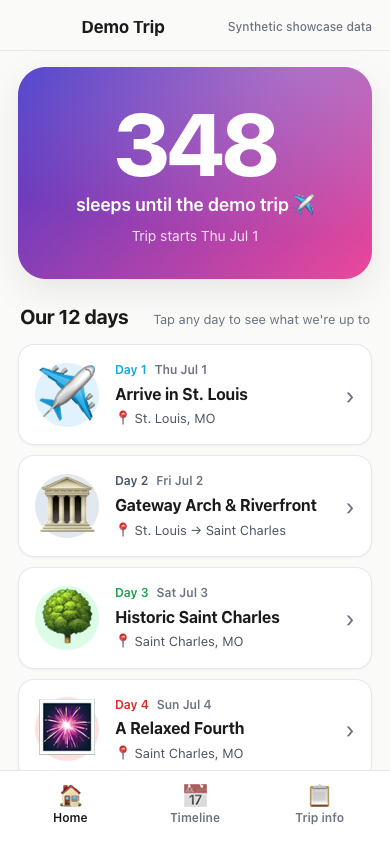
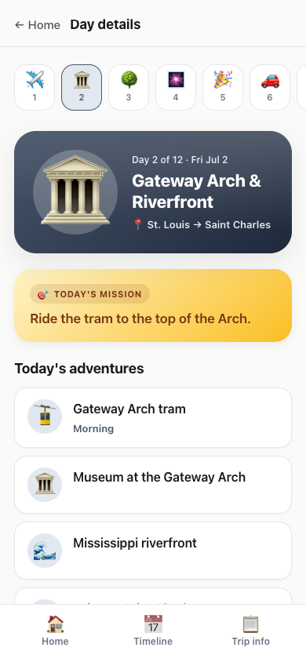
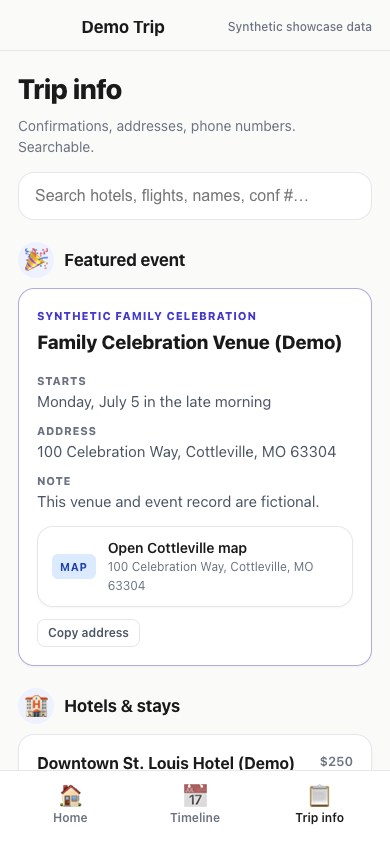

# AI Vacation Planner

A mobile-first React PWA designed to be cloned and adapted to a real trip with a coding agent. Give the agent your itinerary, reservations, destinations, and preferences; the agent reshapes the sample app around your journey.

The included Missouri-and-Tennessee trip is synthetic demonstration data. It shows the kinds of information the app can manage without exposing the private trip that inspired it.

The sanitized template will be hosted as a public project site with GitHub Pages. Its homepage explains the project, the interactive demo lives at `/app/`, and every layer links back to the public repository. Personalized copies containing real trip details should stay private and use private hosting such as Tailscale.

## Screenshots

<p align="center">
  
  
  
</p>

## The intended workflow

1. Clone this repository into a new private repository.
2. Open it with your coding agent of choice.
3. Give the agent your itinerary and supporting trip details.
4. Ask the agent to replace the demo trip and adapt the interface where your trip needs something different.
5. Review the app locally, especially dates, links, addresses, times, and reservation details.
6. Build it and serve it privately to your family—Tailscale is a good option.
7. Install it on each phone as a PWA.

This is intentionally not a rigid itinerary form. Every trip is shaped differently: a wedding weekend needs event logistics, a road trip needs drive legs, and an international trip may need trains, passports, and time-zone context. A coding agent can preserve the useful foundation while refactoring the data model and UI around the actual journey.

## Start here

```bash
git clone https://github.com/cbremer/travel-ai-vacation-planner-demo.git my-trip-app
cd my-trip-app
npm install
npm run dev
```

Create a new private repository for your customized version before adding personal information. Do not push real trip data back to this template repository.

Then give your agent the itinerary and use the prompt in [CUSTOMIZE_WITH_AN_AGENT.md](CUSTOMIZE_WITH_AN_AGENT.md).

Your source material can be rough. Useful inputs include:

- A pasted itinerary or planning document
- Travel dates and time zones
- Flights, trains, rental cars, and drive legs
- Lodging and check-in instructions
- Attractions, restaurants, events, and ticket links
- Addresses and map links
- Travelers and relevant contact details
- Booking status, confirmation numbers, and costs
- Kid-friendly missions, accessibility needs, or daily reminders

Only include sensitive material if you understand where your coding agent sends and stores data. You can also use placeholders first and enter secrets locally later.

## What the agent should customize

The sample data lives in:

- `data/trip.json` — dates, timeline, lodging, flights, bookings, places, budget, checklist, and daily schedule
- `data/day-guide.json` — daily descriptions, adventures, travel context, people, missions, and reminders

The agent should also inspect the app for assumptions that no longer fit. It may need to change navigation, page labels, featured cards, timeline categories, day artwork, data types, or components. The goal is a small app tailored to the trip, not merely valid JSON.

## Verify before relying on it

Run:

```bash
npm run lint
npm run build
npm run preview
```

Then review every day on a phone-sized screen and verify important details against primary sources:

- Dates, local times, and time zones
- Flight or train numbers
- Addresses and map destinations
- Ticket and reservation links
- Opening hours and closure days
- Check-in, checkout, and cancellation rules
- Confirmation numbers and costs

AI can organize these details, but it should not be the final authority for travel-critical information.

## Serve it privately and install the PWA

The app builds to static files in `dist/`. You can preview it locally, host it normally, or expose it privately over your Tailscale network. HTTPS is important for reliable service-worker and installable-PWA behavior.

See [SERVING_AND_PWA.md](SERVING_AND_PWA.md) for:

- Publishing the sanitized template with GitHub Pages
- Production builds
- Tailscale Serve setup
- Updating the running app
- Installing it on iPhone, iPad, and Android
- Offline behavior and privacy considerations

## Features included

- Mobile day-by-day itinerary
- Kid-friendly missions and contextual notes
- Searchable lodging, flights, rental cars, activities, places, and people
- Copyable operational details and quick links
- Timeline, budget, and booking checklist
- Hash routing that works under a subpath
- Installable, offline-friendly PWA behavior
- Structured JSON source of truth

## Privacy

Keep customized trip repositories private by default. Real trip apps can contain names, phone numbers, home addresses, booking codes, travel dates, costs, and clues that a home is unoccupied.

Read [PRIVACY.md](PRIVACY.md) before adding real information or sharing the app outside your private network.

## Template provenance

The included data is synthetic and the Git history is separate from the private production app that inspired it. Customized copies should remain private unless their owners deliberately remove or replace all personal trip information.
